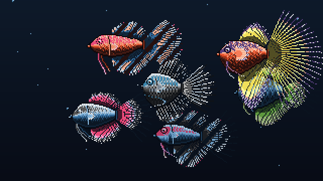

<div align="center">
  <h1>🐟 git-pet</h1>
  <p><strong>A living, procedural pixel-art Betta aquarium that grows with every GitHub commit.</strong></p>

  <p>
    <a href="#-swimming-in-the-aquarium"></a>
    <a href="#-how-it-works--level-progression"></a>
    <a href="#-automatic-github-actions-updates--anti-crowding"></a>
    <a href="#-building--cli-developer-guide"></a>
  </p>
  <br>

  
</div>

<!-- FISH_TABLE_START -->
### 🐠 Swimming in the Aquarium

| Repository | Level & Stage | Languages & Palette | Phenotype | Stars & Activity |
| :--- | :--- | :--- | :--- | :--- |
| [**git-commits-betta-aquarium**](https://github.com/connormmckelvey/git-commits-betta-aquarium) | <kbd>Lv. 2</kbd> 🐠 <b>Juvenile</b><br><code>16 commits</code> | <code>C</code> 90% · <code>Python</code> 10%<br><sub><code>Makefile</code> 1%</sub> | <b>Crowntail Spikes</b><br><sub>Compact Chubby</sub> | ⭐ 0 · 🫧 <b>Active (<48h)</b> |
| [**portfolio**](https://github.com/connormmckelvey/portfolio) | <kbd>Lv. 3</kbd> 🐟 <b>Mature Adult</b><br><code>101 commits</code> | <code>HTML</code> 42% · <code>JavaScript</code> 34%<br><sub><code>CSS</code> 24%</sub> | <b>Veiltail Cascade</b><br><sub>Compact Chubby</sub> | ⭐ 0 · 💤 <i>5d ago</i> |
| [**Haplink**](https://github.com/connormmckelvey/Haplink) | <kbd>Lv. 2</kbd> 🐠 <b>Juvenile</b><br><code>40 commits</code> | <code>Python</code> 79% · <code>C++</code> 18%<br><sub><code>C</code> 3%</sub> | <b>Plakat Fighter Blade</b><br><sub>Agile Predator</sub> | ⭐ 5 · 💤 <i>29d ago</i> |
| [**surgical-cleaning-robot**](https://github.com/connormmckelvey/surgical-cleaning-robot) | <kbd>Lv. 1</kbd> 🍼 <b>Baby Fry</b><br><code>5 commits</code> | <code>Python</code> 39% · <code>C</code> 36%<br><sub><code>C++</code> 14%</sub> | <b>Doubletail Twin-Lobe</b><br><sub>Sleek Torpedo</sub> | ⭐ 0 · 💤 <i>98d ago</i> |
| [**surgical-arm-ros2**](https://github.com/connormmckelvey/surgical-arm-ros2) | <kbd>Lv. 2</kbd> 🐠 <b>Juvenile</b><br><code>21 commits</code> | <code>Python</code> 96% · <code>Shell</code> 3%<br><sub><code>PowerShell</code> 1%</sub> | <b>Doubletail Twin-Lobe</b><br><sub>Royal Crest</sub> | ⭐ 0 · 💤 <i>113d ago</i> |
| [**TACTUS-Medical-Robotics-FRI-Project**](https://github.com/connormmckelvey/TACTUS-Medical-Robotics-FRI-Project) | <kbd>Lv. 2</kbd> 🐠 <b>Juvenile</b><br><code>29 commits</code> | <code>HTML</code> 51% · <code>Python</code> 32%<br><sub><code>C++</code> 17%</sub> | <b>Rosetail Petal-Fringe</b><br><sub>Sleek Torpedo</sub> | ⭐ 0 · 💤 <i>186d ago</i> |
<!-- FISH_TABLE_END -->

---

<details open>
  <summary><h3>🌊 How It Works & Level Progression</h3></summary>
  <br>

Every repository grows its own living procedural Betta fish shaped by its genetic commit history:

| Level | Growth Stage | Commit Milestone | Anatomical & Behavioral Evolution |
| :---: | :--- | :---: | :--- |
| <kbd>Lv. 1</kbd> | 🍼 **Baby Fry** | `1 – 11` | Compact chubby body, baby belly, short fin buds, large curious eyes |
| <kbd>Lv. 2</kbd> | 🐠 **Juvenile** | `12 – 59` | Spine lengthening, fin ray branching, agile and alert swimming |
| <kbd>Lv. 3</kbd> | 🐟 **Mature Adult** | `60 – 249` | Full sprawling caudal fan, towering dorsal sail, and flowing anal curtain |
| <kbd>Lv. 4</kbd> | 👑 **Master Elder** | `250 – 999` | Grand cascading waterfall finnage, peony petal ruffles, majestic posture |
| <kbd>Lv. 5</kbd> | 🐉 **Mythic Leviathan** | `1,000+` | Titan morphology, needle ray spikes, armored iridescence |

#### 🧬 Biological Features & GitHub Aura
- **Rapid Pectoral Hover**: Translucent pectoral fins flutter at 4x the swimming tempo behind the gill plate to maintain station.
- **Natural Eye Blinks**: Fish naturally rest their eyes for 2 frames at staggered intervals.
- **Star Glint Sparkles**: Repos with GitHub stars twinkle diamond scale glints across their flank.
- **Recent Commit Bubble Puffs**: Active repos (<48 hours) emit rising micro-bubble puffs from the mouth.
- **Multi-Color Linguist Genetics**: Repository programming languages dictate primary scale, fin veil, and accent iridescent sheen.
</details>

<details>
  <summary><h3>🔄 Automatic GitHub Actions Updates & Anti-Crowding</h3></summary>
  <br>

The tank manages itself autonomously via [`.github/workflows/aquarium.yml`](.github/workflows/aquarium.yml):
1. **Activity Deadline (`--deadline-days 365`)**: Repositories inactive for over a year retire to prevent overcrowding.
2. **Tank Capacity Limit (`--max-fish 6`)**: Caps the aquarium population at 6 fish so every fish has open swimming territory.
3. **Weekly Sweeps (`cron: '0 0 * * 0'`)**: Automatically evaluates deadlines weekly even when no new commits occur.
4. **Instant Push Updates**: Pushing code triggers an instant update and grows the corresponding fish.

```yaml
python scripts/update_aquarium.py \
  --user "${{ github.repository_owner }}" \
  --deadline-days 365 \
  --max-fish 6 \
  --mode stream \
  --out assets/aquarium.gif
```
</details>

<details>
  <summary><h3>🌐 Display On Your Personal Website</h3></summary>
  <br>

Add this snippet to your portfolio, blog, or personal website:

```html
/git-pet/main/assets/aquarium.gif" 
  alt="Live Git Aquarium" 
  width="480" 
/>
```
</details>

<details>
  <summary><h3>💻 Building & CLI Developer Guide</h3></summary>
  <br>

Built in pure C99 with zero external dependencies (compiles in ~0.5s):

```bash
# Build engine
make
# or directly:
gcc -O2 src/*.c -o git-betta -lm

# Render a single repository pet
./git-betta --repo "connor/git-pet" --commits 50 --languages "C:85,Shell:15" --animated --out pet.gif

# Render growth time-lapse animation (1 to 1000 commits)
./git-betta --repo "connor/git-pet" --commits 1000 --languages "C:70,Python:25,Shell:5" --grow --out growth.gif

# Render multi-fish aquarium simulation
./git-betta --aquarium --stream --fish-count 6 \
  --seeds "connor/git-pet,portfolio,Haplink" \
  --fish-commits "13,101,40" \
  --fish-stars "0,0,5" \
  --fish-recent "1,0,0" \
  --out aquarium.gif
```
</details>
